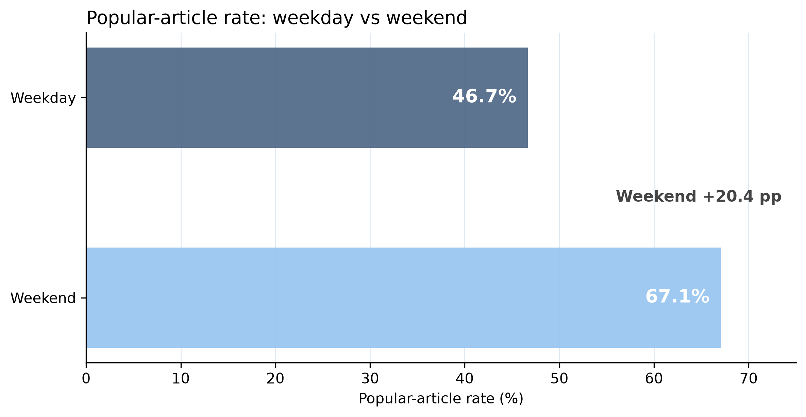

# Online News Popularity Prediction

A Python and R project for data preparation, exploratory analysis, and binary news popularity classification with **logistic regression, CART, and random forest**.

An article is labeled **Popular** when `shares > 1400`. Articles with exactly 1,400 shares are labeled Not Popular. The project predicts this class rather than the number of shares.

## Dataset and verified preparation

The project uses the six supplied analysis files. The raw CSV contains **39,644 rows and 61 columns**. The cleaning workflow removes **one record** with a token-ratio value outside [0, 1], then adds six derived fields, yielding **39,643 rows and 67 columns**.

The supplied cleaned CSV was independently compared with the notebook's transformation: all fields agree within numerical tolerance 1e-12, with identical column and article order. It has no missing cells or duplicate URLs. All **1,181 zero-content articles** are retained and flagged with `empty_content`.

**19,561 articles (49.34%)** are labeled Popular. Data provenance and public redistribution terms still need verification; see [data notes](data/README.md). No dataset license or external source attribution is inferred from the filenames.

## Analysis included

- Share-count distributions on original and logarithmic scales.
- Popularity rates by publication weekday, weekday/weekend, and article channel.
- Observed rates by content length, image count, and video count, with Wilson 95% confidence intervals.
- Temporal split summaries and a check of popularity-rate differences across periods.
- Ordinary logistic regression with training-only scaling, adjusted odds ratios, likelihood-ratio tests, collinearity and influence diagnostics.
- CART pruning and classification-threshold selection on Validation.
- A nine-combination random forest validation search, final refitting, importance plots, and article probability ranking.

## Descriptive findings

In the cleaned data, the observed popular rate is **67.07% on weekends** and **46.67% on weekdays**. These are unadjusted associations and do not establish that changing publication timing causes higher popularity.

The share distribution is right-skewed: median **1,400**, mean **3,395.32**, and maximum **843,300**. Content-format plots restrict their display to the 99th percentile; those plotting limits do not remove high-value articles from the modeling data.



## Temporal evaluation

| Partition | Rule on timedelta | Articles | Popular rate |
|---|---|---:|---:|
| Training | >= 265 | 23,793 | 50.89% |
| Validation | 132–264 | 7,966 | 50.46% |
| Test | <= 131 (observed 8–131) | 7,884 | 43.53% |

The scripts preserve the supplied temporal partitions. The lower Test popularity rate matters when interpreting accuracy and calibration. Calendar dates are not inferred from `timedelta`.

## Reference-run results

| Workflow | Test accuracy | Test AUC | Decision rule |
|---|---:|---:|---|
| Logistic regression | 66.11% | Not exported | Probability >= 0.50 |
| CART | 65.68% | 0.6822 | Probability > 0.45, validation-selected |
| Random forest | 67.90% | Not exported | Forest class vote |


These are freshly executed results from the portable copies, not claimed original scores. The workflows differ: logistic regression uses Training with a fixed 0.5 cutoff; CART tunes pruning and threshold on Validation; random forest selects hyperparameters on Validation and refits on Training + Validation. Predictor sets also differ. This is **not a controlled algorithm comparison**.

Metric details and predictions are written under `reports/<model>/`. Logistic regression additionally reports precision, recall, specificity, and F1. CART reports AUC; random forest reports OOB error, false-positive rate, and false-negative rate. Metrics not exported by a workflow are not invented for the table.

## Repository layout

```text
online-news-popularity-prediction/
├── README.md
├── requirements.txt
├── requirements-notebook.txt
├── data/
│   ├── README.md
│   ├── raw/OnlineNewsPopularity.csv
│   └── processed/m2_cleaned_data.csv
├── notebooks/01_data_cleaning_and_eda.ipynb
├── R/
│   ├── logistic_regression.R
│   ├── cart.R
│   └── random_forest.R
├── scripts/
│   ├── run_eda.py
│   └── install_packages.R
├── originals/                  # Four unchanged supplied code files
├── reports/
│   ├── audit/                  # Source hashes and data checks
│   ├── eda/                    # Seven tables and six figures
│   ├── logistic/
│   ├── cart/
│   └── random_forest/
└── docs/                       # Audit, GitHub guide, profile snippet
```

## Run the project

Run all commands from the repository root. Install Python and R separately. The local reference environment is documented in `reports/audit/python_environment.json` and the model `sessionInfo.txt` files. Python core dependencies are pinned to tested versions; the R setup script installs available package versions and is not a historical lockfile.

```bash
python -m venv .venv
# macOS/Linux
source .venv/bin/activate
# Windows PowerShell: .venv\Scripts\Activate.ps1
python -m pip install -r requirements.txt
python scripts/run_eda.py
Rscript scripts/install_packages.R
Rscript R/logistic_regression.R
Rscript R/cart.R
Rscript R/random_forest.R
```

The headless runner executes every notebook code cell in order, exports the cleaned CSV, and writes figures/tables without a Jupyter server. Alternatively, install `requirements-notebook.txt`, start `jupyter lab`, and open the notebook. The notebook supports launching from the repository root or `notebooks/`.

Random forest evaluates nine configurations and can take several minutes. The scripts overwrite generated outputs. Fitted `.rds` models are generated by the scripts and omitted from the downloadable starter ZIP. Original code is retained for inspection; it contains personal paths and should not be used as the default execution route.

## Reproducibility and limitations

The portable version fixes personal paths, the notebook/model filename mismatch, and random forest ranking with the wrong model object. It also hardens CART confusion-table handling and uses a base-R empirical AUC calculation. See the [complete audit](docs/REPRODUCIBILITY.md) for exact changes.

The models exclude direct `shares` leakage. However, historical keyword and self-reference share aggregates remain; their availability at the intended prediction time must be verified before claiming leakage-free pre-publication prediction. Share-accumulation windows may differ across article ages. Full-data exploratory analysis includes Test-period data. Statistical significance, feature importance, and observational associations do not establish causal effects.

## Tools and skills

**Tools:** Python · Pandas · NumPy · Matplotlib · IPython/Jupyter · R · rpart · rpart.plot · randomForest · data.table · ggplot2

**Skills:** Data Cleaning · Exploratory Data Analysis · Binary Classification · Temporal Validation · Model Evaluation · Statistical Interpretation · Reproducible Analysis

## License and attribution

No license is assigned automatically. Confirm ownership of the analysis code and the original dataset's citation and redistribution terms before public release. See [data provenance](data/README.md).
